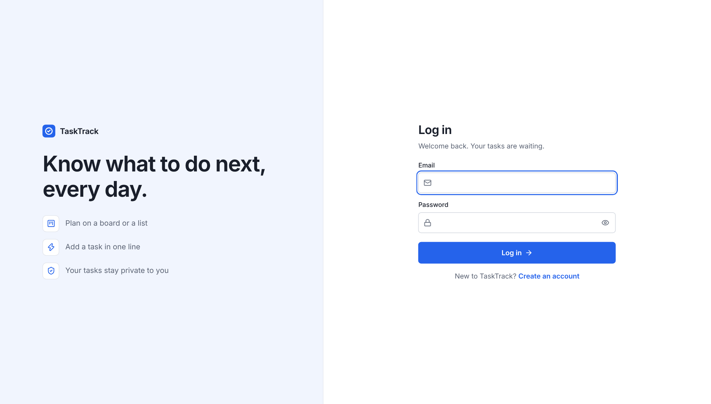
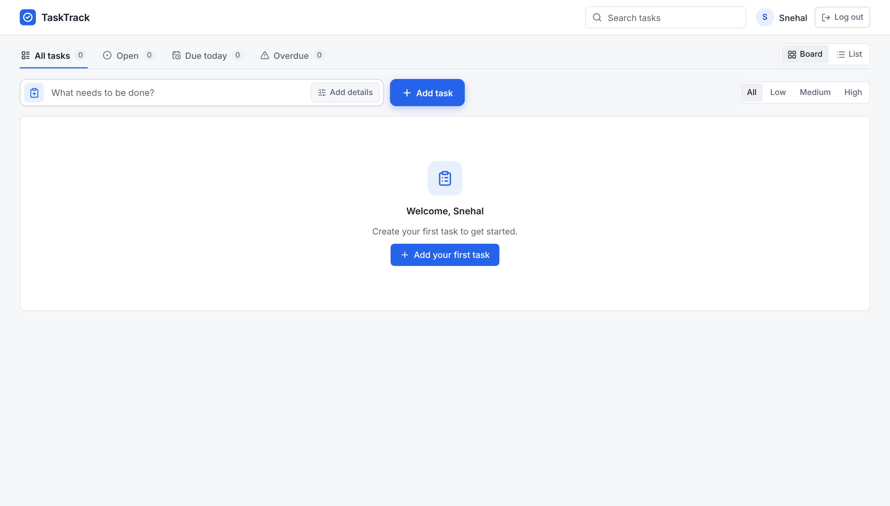
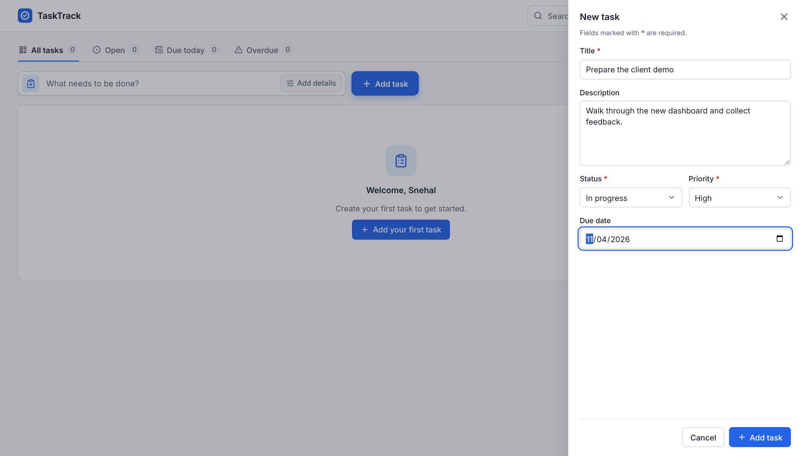
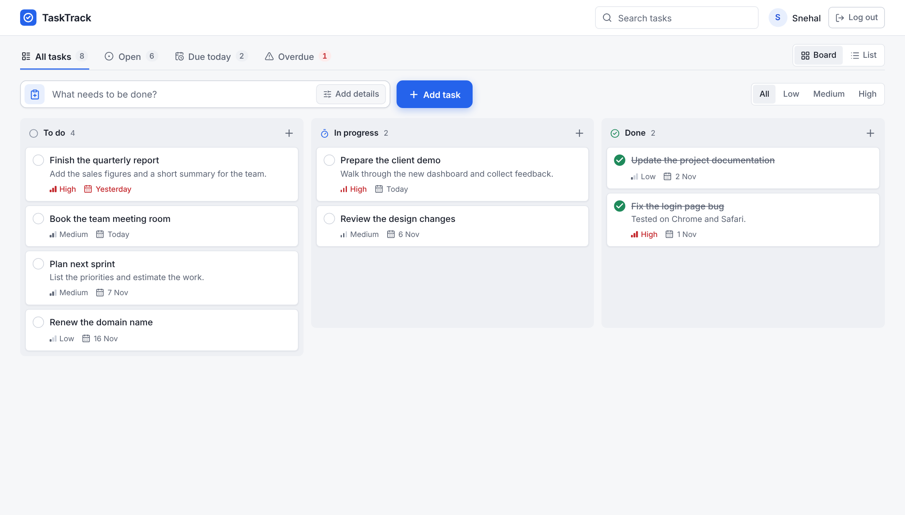
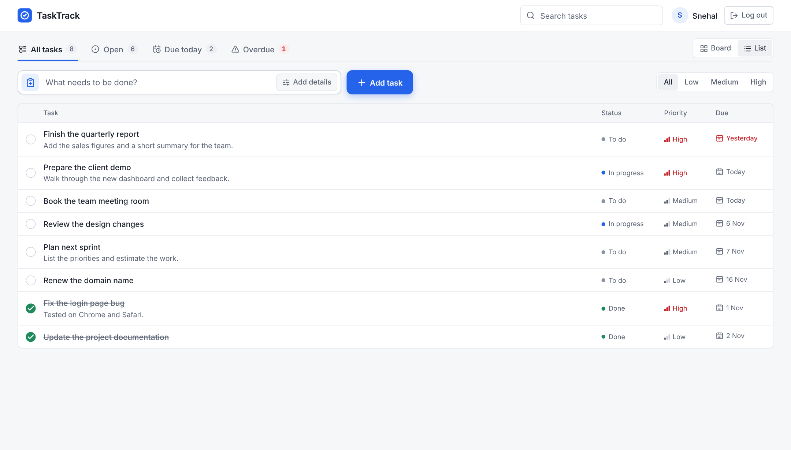

# TaskTrack

A simple task manager where each person has a private account to create, organise and track their own tasks.

**Live app:** https://task-track-oogf.onrender.com

## Screenshots

**Log in**



**Before adding tasks**



**Adding a task**



**After adding tasks: board view**



**List view**



## The task

Build a simple application that allows users to create and manage tasks.

## What I understood

The brief says users, so this had to work for more than one person. If everyone shared one list, it would not be useful to any individual. Each user needs their own account and should see only their own tasks.

Creating and managing tasks means being able to add, view, edit, complete and delete them. I also wanted it to be quick to use, and clear about what needs attention today.

## What I built

- Sign up, log in and log out, with tasks private to each user
- Add, edit and delete tasks, with undo after a delete
- Title, description, status, priority and due date on each task
- A board with drag and drop, and a list sorted by urgency
- Tabs for all, open, due today and overdue tasks
- Search and a priority filter
- A notification for every action
- A layout that works on phones

**Built with:** MongoDB, Express, React, Node.js and TypeScript

## Run it locally

You need Node.js 22.13 or newer, and MongoDB running locally or a MongoDB Atlas connection string.

1. Clone the project and install the packages:

   ```bash
   git clone https://github.com/Snehal-Salvi/Task-Track.git
   cd Task-Track
   npm install
   ```

2. Create the environment file:

   ```bash
   cp backend/.env.example backend/.env
   ```

3. Open `backend/.env` and set your values:

   ```
   MONGODB_URI=mongodb://127.0.0.1:27017/tasktrack
   PORT=4000
   JWT_SECRET=any-long-random-text
   ```

4. Start the app:

   ```bash
   npm run dev
   ```

5. Open http://localhost:5173 and create an account.

To run the tests, use `npm test`. The backend tests need MongoDB running locally.
